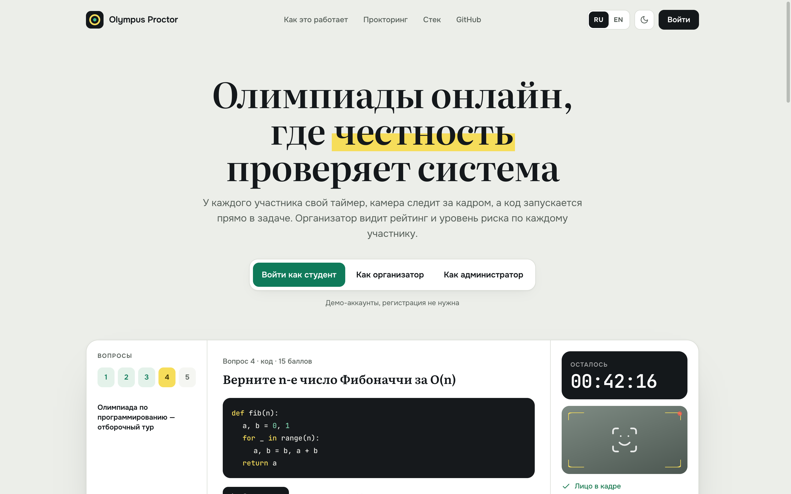
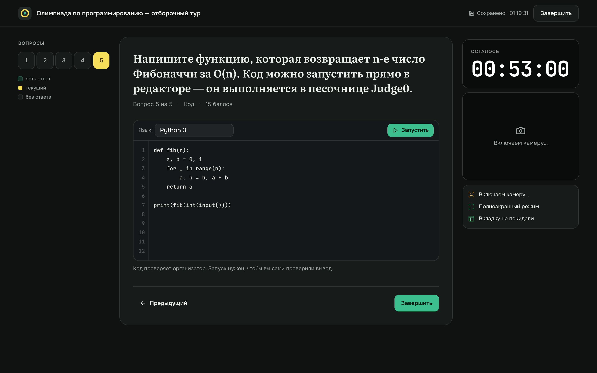
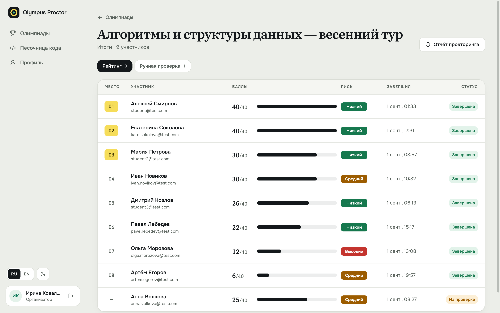
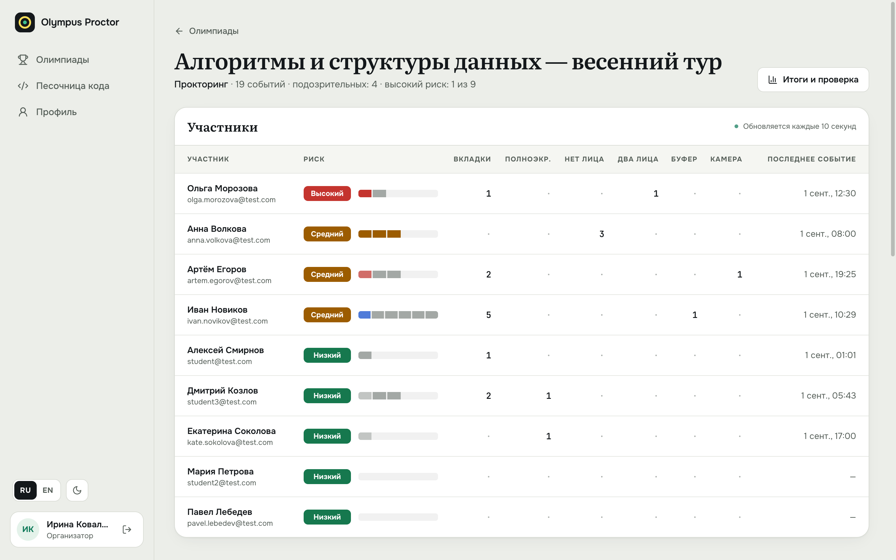
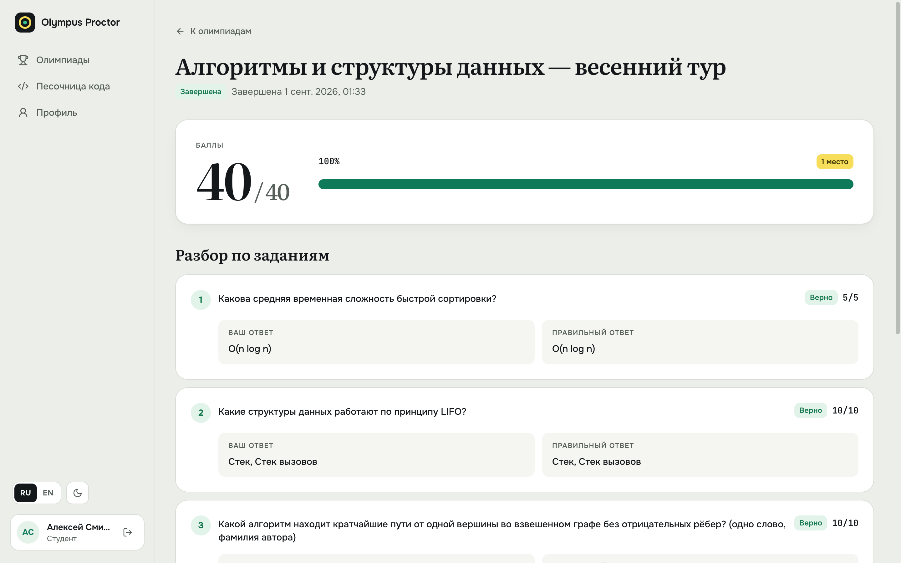

# Olympus Proctor

Online olympiads end to end: an organizer creates questions and a start window, students take a timed attempt with camera proctoring and a code sandbox, answers are graded automatically or by hand, and the organizer sees a ranking with a per-participant cheating-risk level next to each score.

Full-stack pet project: Java 21 / Spring Boot 3.5 / PostgreSQL on the back, React 18 / TypeScript on the front. Interface in Russian and English.



## Try it

Every role has a one-click demo account — the buttons on the landing page and the login page sign you in directly.

| Role | Email | Password | What to look at |
| --- | --- | --- | --- |
| Student | `student@test.com` | `student123` | open olympiad → briefing → attempt; finished olympiad → result breakdown |
| Organizer | `org@test.com` | `org123` | finished olympiad → ranking with risk, manual review queue, proctoring report; question editor |
| Admin | `admin@test.com` | `admin123` | users: roles, blocking |

The demo database (migration `V6`) has four olympiads — open, finished with a 9-person ranking, upcoming and draft — plus proctoring events. Demo content is in Russian in both UI languages: it is data, not interface text.

## Features

**Attempt**
- Individual timer: a student can start anywhere inside the start window and gets the full duration from their own start time. Attempts close on the server at the deadline (scheduled job), and the score is computed even if the browser is gone.
- Five question types: single choice, multiple choice, short text, code (runs in the [Judge0](https://judge0.com) sandbox), and manual review with a file attachment.
- Answers autosave with debounce, flush on finish, and restore after a reload.
- Rules and tracked signals are shown before the timer starts; the attempt runs in a dark exam mode, fully keyboard-operable.

**Proctoring**
- Browser signals: tab switch, fullscreen exit, clipboard paste.
- Camera signals via in-browser face detection ([`@vladmandic/face-api`](https://github.com/vladmandic/face-api), tiny face detector, loaded lazily): face missing, multiple faces, camera unavailable. Video never leaves the browser — only events are sent.
- The server decides what is suspicious: repeated events of the same type within 5 minutes beyond a tolerance (tab switch > 3, fullscreen exit > 2, face missing > 1, paste > 2), or any multiple-faces / camera-denied event.
- Each participant gets a risk level: **High** (3+ flagged events or a second face), **Medium** (any flagged event or 5+ events), **Low**. It is a signal for a human reviewer, not a verdict.

**Organizer and admin**
- Olympiad form with a start window, duration and a public-holiday warning ([Nager.Date](https://date.nager.at)); draft → publish.
- Question editor with an option list and correct-answer marking.
- Ranking with places, score bars and risk; manual review queue with score and comment.
- Proctoring report: summary, per-participant counters by signal type, event feed with auto-refresh.
- Admin: users table with search, role filter, role change and blocking (an admin cannot demote or block themselves).

**Security**
- JWT access + refresh tokens; expired token → 401 → the client refreshes transparently; blocked users cannot refresh.
- Role checks at URL and service level; students never receive correct answers or results during an active attempt; organizers can only touch their own olympiads and questions.
- Attachments are served only to authorized users, with path-traversal protection.
- Error responses never leak exception messages.

## Screenshots

| | |
| --- | --- |
|  |  |
| Attempt — code question, ink timer, proctoring status | Organizer ranking with risk levels |
|  |  |
| Proctoring report | Student result with reviewer comments |

## Stack

| | |
| --- | --- |
| Backend | Java 21, Spring Boot 3.5, Spring Security, Spring Data JPA, PostgreSQL, Flyway, JWT (jjwt), Lombok, Actuator |
| Frontend | React 18, TypeScript, Vite, Tailwind CSS, Zustand, React Router, React Hook Form + Zod, Axios |
| External | Judge0 (code execution), Nager.Date (holidays), Google Sign-In (optional) |
| Tests | JUnit 5, Mockito, JaCoCo (the build fails below 40% instruction coverage of the service layer) |
| Infra | Docker Compose, nginx; Vercel + any Docker host for deployment |

No UI kit: components, design tokens, light/dark themes and the RU/EN i18n layer (with pluralization) are written in the project.

## Architecture

```text
browser ── React SPA ──/api──► Spring Boot ──► PostgreSQL (Flyway)
  │  face-api (camera, local)        │
  │  proctoring events ─────────────►│ CheatingDetectionService → risk level
  │                                  ├──► Judge0      (code runs)
  │                                  └──► Nager.Date  (holiday warning)
```

- `backend/olimpiad-platform` — controllers → services → JPA repositories; DTOs at the API boundary; `GlobalExceptionHandler` maps `BusinessException` to 400/403/404. All timestamps are stored and sent in UTC; the client renders local time.
- `frontend/src` — `pages/` (one per route), `components/{ui,domain,layout}`, `hooks/` (proctoring, camera, demo login), `i18n/`, `api/` (Axios client with refresh-token interceptor), `store/` (Zustand).

## Run locally

Requirements: JDK 21+, Maven, Node 20+, PostgreSQL 15+.

```bash
# 1. database
createdb olympiad_db            # user/password postgres/postgres by default

# 2. backend → http://localhost:8080
cd backend/olimpiad-platform
mvn spring-boot:run             # SPRING_DATASOURCE_URL=... to point elsewhere

# 3. frontend → http://localhost:5173 (proxies /api to :8080)
cd frontend
npm install
npm run dev
```

The local profile uses a development-only JWT secret; set `APP_JWT_SECRET` anywhere else.

Or everything in containers: see [DOCKER.md](DOCKER.md). Deployment (Vercel + Render/Railway/Fly + Neon/Supabase): see [docs/DEPLOY.md](docs/DEPLOY.md).

## Tests and checks

```bash
cd backend/olimpiad-platform && mvn test          # 49 tests + JaCoCo coverage check
cd frontend && npm run lint && npm run build      # ESLint, tsc, production build
```

---

## Кратко по-русски

**Olympus Proctor** — платформа онлайн-олимпиад: создание олимпиад и вопросов, попытка с личным таймером, прокторинг камерой и браузерными сигналами, песочница кода, авто- и ручная проверка, рейтинг с уровнем риска списывания у каждого участника.

- Демо-вход в один клик с главной страницы: студент `student@test.com / student123`, организатор `org@test.com / org123`, администратор `admin@test.com / admin123`.
- Интерфейс на русском и английском (переключатель в шапке), светлая и тёмная темы.
- Запуск: локально — раздел «Run locally» выше; в Docker — [DOCKER.md](DOCKER.md); деплой — [docs/DEPLOY.md](docs/DEPLOY.md).
